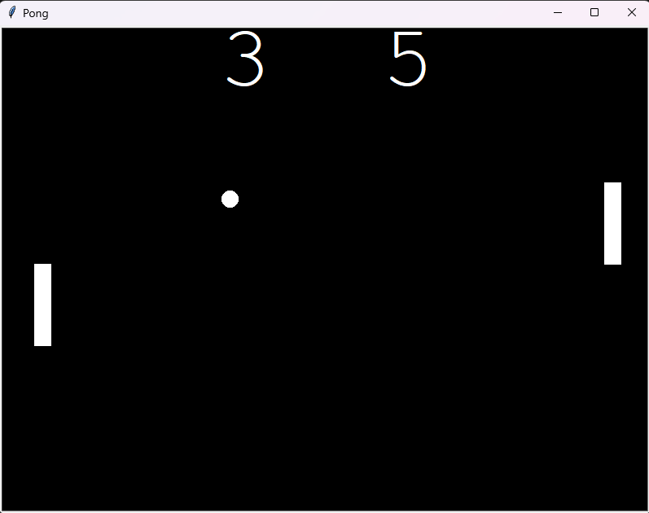

# Pong Game

The classic Pong arcade game for two players, built with Python's `turtle` module
as the Day 22 assignment of Udemy's *100 Days of Code: The Complete Python Pro
Bootcamp*. It has no runtime dependencies.

## 📚 Table of Contents

- [Overview](#-overview)
- [Requirements](#-requirements)
- [Setup](#-setup)
- [Run](#-run)
- [Tests](#-tests)
- [License](#-license)
- [Links](#-links)
- [Appendix: Project documents](#-appendix-project-documents)

## 🧭 Overview

Guides are in the [project wiki][documentation], in English, Dansk and Bahasa Melayu.



### Project layout

| Path | Contents |
| --- | --- |
| `.editorconfig` | Editor settings of the framework baseline |
| `.env.example` | Placeholders for the tokens of the framework scripts |
| `src/` | Game source: `main.py`, `paddle.py`, `ball.py`, `scoreboard.py`, `rules.py`, `constants.py` |
| `tests/` | pytest tests |
| `docs/` | Project documents (business case, plan, milestones, reviews, traceability), `docs/wiki/` (the wiki) and `docs/images/` (screenshot) |
| `framework/` | SQA and QC framework (git submodule) |
| `pyproject.toml` | Project configuration |
| `Doxyfile` | Doxygen configuration |

## 📋 Requirements

- Python 3.13 or newer, with Tk support (`turtle` needs it)
- `git`
- Doxygen (optional, only to build the source documentation)

## 🛠️ Setup

Clone the repository, then create and use a local `.venv` and update `pip` inside it.

```bash
git clone ssh://git@git.tirsystem.com:10022/Tirsvad-Udemy-100-days-of-code/022-pong-game.git
cd 022-pong-game
```

### Windows powershell

```powershell
python -m venv .venv
.\.venv\Scripts\Activate.ps1
python -m pip install --upgrade pip
python -m pip install -e ".[dev]"
```

### Linux debian

```bash
sudo apt install python3-venv python3-tk
python3 -m venv .venv
source .venv/bin/activate
python -m pip install --upgrade pip
python -m pip install -e ".[dev]"
```

### MacOS

```bash
python3 -m venv .venv
source .venv/bin/activate
python -m pip install --upgrade pip
python -m pip install -e ".[dev]"
```

## ▶️ Run

```bash
python src/main.py
```

Right paddle: <kbd>Up</kbd> / <kbd>Down</kbd>. Left paddle: <kbd>W</kbd> / <kbd>S</kbd>.
Click the window to close it.

### Build the source documentation

```bash
doxygen Doxyfile
```

The HTML output is written to `docs/doxygen/html/index.html`.

## 🧪 Tests

```bash
python -m pytest
```

### Continuous integration

`.gitea/workflows/ci.yml` installs the project with the `dev` extra and runs
`python -m pytest` on every push to `main` and on every pull request.

## 📄 License

GNU AGPL v3, see [LICENSE][license].

## 🔗 Links

- [Repository][repository]
- [Documentation][documentation]
- [Issue tracker][issues]

## 📎 Appendix: Project documents

The documents a newcomer needs, in reading order.

| Document | What it tells you |
| --- | --- |
| [Business Case][BC-001] | Why the project exists, its scope and success criteria |
| [Stakeholder Analysis][SA-001] | Who is involved; the stakeholder IDs used for owners and reviewers |
| [Project Plan][PP-001] | The milestones and their schedule |
| [Milestones][milestones] | One document per milestone: Go/No-Go criteria and tasks |
| [Artifact registry][registry] | Where each artifact type lives, the next version, the PO language and domain |
| [Traceability matrix][TM-001] | How the artifacts link and when each was last reviewed |

---

[repository]: https://git.tirsystem.com/Tirsvad-Udemy-100-days-of-code/022-pong-game
[documentation]: https://git.tirsystem.com/Tirsvad-Udemy-100-days-of-code/022-pong-game/wiki
[issues]: https://git.tirsystem.com/Tirsvad-Udemy-100-days-of-code/022-pong-game/issues
[license]: ./LICENSE
[BC-001]: ./docs/business-case.md
[SA-001]: ./docs/stakeholder-analysis.md
[PP-001]: ./docs/project-plan.md
[milestones]: ./docs/milestones/
[registry]: ./docs/artifact-registry.md
[TM-001]: ./docs/sqa/traceability-matrix.md
