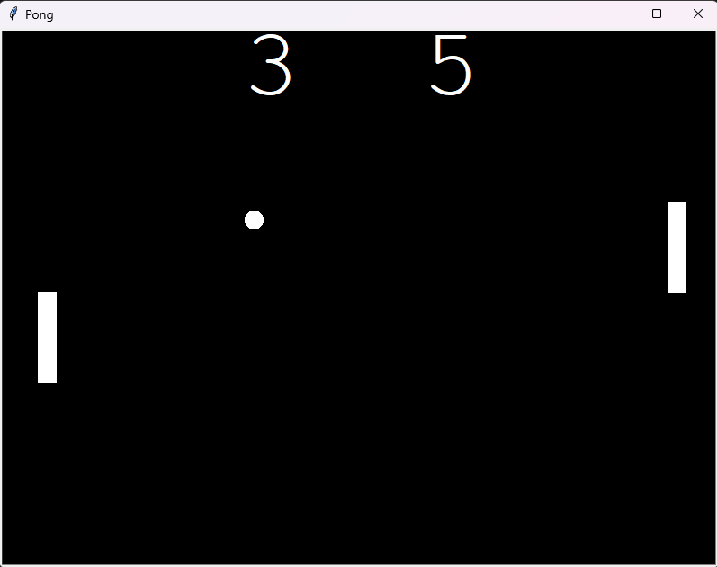

# Pong Game

The classic Pong arcade game for two players, built with Python's `turtle` module
as the Day 22 assignment of Udemy's *100 Days of Code: The Complete Python Pro
Bootcamp*. It has no runtime dependencies.

Guides are in the [project wiki][wiki], in English, Dansk and Bahasa Melayu.



## Requirements

- Python 3.13 or newer, with Tk support (`turtle` needs it)
- `git`
- Doxygen (optional, only to build the source documentation)

## Set up

Clone the repository, then create and use a local `.venv` and update `pip` inside it.

```bash
git clone ssh://git@git.tirsystem.com:10022/Tirsvad-Udemy-100-days-of-code/022-pong-game.git
cd 022-pong-game
```

### Windows powershell

```powershell
python -m venv .venv
.\.venv\Scripts\Activate.ps1
python -m pip install --upgrade pip
python -m pip install -e ".[dev]"
```

### Linux debian

```bash
sudo apt install python3-venv python3-tk
python3 -m venv .venv
source .venv/bin/activate
python -m pip install --upgrade pip
python -m pip install -e ".[dev]"
```

### MacOS

```bash
python3 -m venv .venv
source .venv/bin/activate
python -m pip install --upgrade pip
python -m pip install -e ".[dev]"
```

## Run

```bash
python src/main.py
```

Right paddle: <kbd>Up</kbd> / <kbd>Down</kbd>. Left paddle: <kbd>W</kbd> / <kbd>S</kbd>.
Click the window to close it.

## Run the tests

```bash
python -m pytest
```

## Continuous integration

`.gitea/workflows/ci.yml` installs the project with the `dev` extra and runs
`python -m pytest` on every push to `main` and on every pull request.

## Build the source documentation

```bash
doxygen Doxyfile
```

The HTML output is written to `docs/doxygen/html/index.html`.

## Project layout

| Path | Contents |
| --- | --- |
| `src/` | Game source: `main.py`, `paddle.py`, `ball.py`, `scoreboard.py`, `rules.py`, `constants.py` |
| `tests/` | pytest tests |
| `docs/` | Project documents (business case, plan, milestones, reviews) and `docs/images/` (screenshot) |
| `framework/` | SQA and QC framework (git submodule) |
| `pyproject.toml` | Project configuration |
| `Doxyfile` | Doxygen configuration |

## License

GNU AGPL v3, see [LICENSE](LICENSE).

[wiki]: https://git.tirsystem.com/Tirsvad-Udemy-100-days-of-code/022-pong-game/wiki
