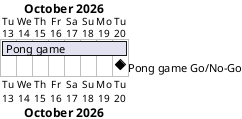

# Project Plan

## Metadata
| Key | Value |
| --- | --- |
| ID | PP-001 |
| CrossReference | [BC-001], [SA-001] |
| Language | en |
| Domain | it |

## Version History
| Date | Status | Author | Reviewer | Change | Commit |
| --- | --- | --- | --- | --- | --- |
| 2026-10-13 | Deprecated | Jens Tirsvad Nielsen | S01 | Initial version | [0a05352] |
| 2026-10-13 | Accepted | Jens Tirsvad Nielsen | AI as stand-in for S01 | Accepted by the Product Owner's acceptance of the plan | [0a05352] |

---

## Purpose

Schedules the single delivery gateway of the Pong game, MIL-001, within one week.

## Planning Assumptions

- Week 1 starts 2026-10-13; the plan ends by 2026-10-20.
- Phase length: one week; one pull request per task keeps track of the steps.

## Gateway Schedule

| Gateway | Document | Window | Decision date | Owner | Stories | Main deliverable | Milestone |
| --- | --- | --- | --- | --- | --- | --- | --- |
| Pong game | [MIL-001] | 2026-10-13 to 2026-10-20 | 2026-10-20 | S01 | none | Playable, tested, documented Pong game | not yet synced |



## Scope Coverage

| Business Case scope item | Gateway |
| --- | --- |
| Game screen, paddles, ball, bounces, reset, scoreboard, speed-up | MIL-001 |
| Constants, Doxygen, Doxyfile, pyproject, .gitignore, README, tests, CI | MIL-001 |
| Repository description and topics | MIL-001 |

## Dependencies

```
MIL-001 (no further phases)
```

## Plan Risks

| Risk | Impact | Mitigation |
| --- | --- | --- |
| Review of each step delays the schedule | Gateway date slips | S01 is both developer and reviewer; keep tasks small |

## Open Issues

- None.

---

[MIL-001]: ./milestones/mil-001-pong-game.md
[BC-001]: ./business-case.md
[SA-001]: ./stakeholder-analysis.md
[0a05352]: https://git.tirsystem.com/Tirsvad-Udemy-100-days-of-code/022-pong-game/commit/0a0535278c3495c997b5cf36fb52f5573bfe0b35
