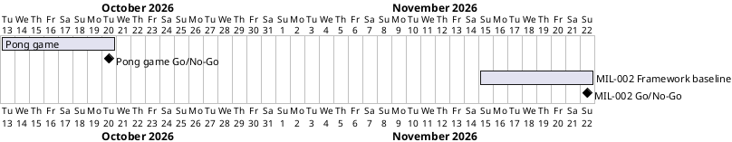

# Project Plan

## Metadata
| Key | Value |
| --- | --- |
| ID | PP-001 |
| CrossReference | [BC-001], [SA-001], [MIL-001], [MIL-002] |
| Language | en |
| Domain | education |

## Version History
| Date | Status | Author | Reviewer | Change | Commit |
| --- | --- | --- | --- | --- | --- |
| 2026-10-13 | Deprecated | Jens Tirsvad Nielsen | S01 | Initial version | [0a05352] |
| 2026-10-13 | Deprecated | Jens Tirsvad Nielsen | AI as stand-in for S01 | Accepted by the Product Owner's acceptance of the plan | [0a05352] |
| 2026-11-15 | Accepted | Jens Tirsvad Nielsen | AI as stand-in for S01 | Added the baseline milestone MIL-002, its scope coverage, dependency, risk and Gantt entries and the No-Go rule; linked the milestone of MIL-001 on the git host; set the domain to education; reviewed in autonomous mode, not independent | pending |

---

## Purpose

Schedules the single delivery gateway of the Pong game, MIL-001, within one week. A second gateway, [MIL-002], was added on 2026-11-15 to bring the finished project to the baseline of the framework; it runs from 2026-11-15 to 2026-11-22.

## Planning Assumptions

- Week 1 starts 2026-10-13; the plan ends by 2026-10-20.
- Phase length: one week; one pull request per task keeps track of the steps.
- The baseline gateway [MIL-002] starts 2026-11-15 and ends by 2026-11-22, one week (source: [BC-001], Assumptions). The end date of the plan moves from 2026-10-20 to 2026-11-22 because of it; the reason is the agreed minimum quality baseline of the framework.
- For [MIL-002] S01 has authorised the assistant to commit, push, open the pull request and merge it, and the review is done by an AI stand-in for S01 (source: [BC-001], Constraints; [SA-001], Conflicting Interests and Mitigations).

## Gateway Schedule

| Gateway | Document | Window | Decision date | Owner | Stories | Main deliverable | Milestone |
| --- | --- | --- | --- | --- | --- | --- | --- |
| Pong game | [MIL-001] | 2026-10-13 to 2026-10-20 | 2026-10-20 | S01 | none | Playable, tested, documented Pong game | [milestone-97] |
| Framework baseline | [MIL-002] | 2026-11-15 to 2026-11-22 | 2026-11-22 | S01 | none | The framework release, the wiki in three languages, the README in the framework template, the licence metadata, the traceability matrix and the review records | [milestone-530] |



## Scope Coverage

| Business Case scope item | Gateway |
| --- | --- |
| Game screen, paddles, ball, bounces, reset, scoreboard, speed-up | MIL-001 |
| Constants, Doxygen, Doxyfile, pyproject, .gitignore, README, tests, CI | MIL-001 |
| Repository description and topics | MIL-001 |
| The baseline milestone: framework release, wiki, README template, licence metadata, traceability matrix, review records | MIL-002 |

## Dependencies

```
MIL-001 → MIL-002
```

MIL-002 depends on MIL-001: it documents and baselines the finished game and changes no code. A No-Go on a gateway returns it to S01 and moves the dates of the later gateway and the end date; S01 decides the new date. A No-Go on [MIL-002] leaves the game and MIL-001 as they are.

## Plan Risks

| Risk | Impact | Mitigation |
| --- | --- | --- |
| Review of each step delays the schedule | Gateway date slips | S01 is both developer and reviewer; keep tasks small |
| A continuous integration (CI) check fails on the pull request of [MIL-002] | The merge is delayed past 2026-11-22 | The failure is fixed on the same branch and the checks run again; after three failed rounds on one cause the work stops and S01 decides (trace: success criterion 5 of [BC-001]) |

## Open Issues

- No use case or user story is modelled: the tasks of both gateways are technical or documentation tasks, so the Stories column says `none`.
- **Published wiki:** the wiki is checked on the git host after the merge, because the host copies it only then.
- **Milestone of MIL-001 on the git host:** milestone 97 exists and all its issues are closed, but the milestone itself is still open on the host.

---

[MIL-001]: ./milestones/mil-001-pong-game.md
[BC-001]: ./business-case.md
[SA-001]: ./stakeholder-analysis.md
[0a05352]: https://git.tirsystem.com/Tirsvad-Udemy-100-days-of-code/022-pong-game/commit/0a0535278c3495c997b5cf36fb52f5573bfe0b35
[MIL-002]: ./milestones/mil-002-framework-baseline.md
[milestone-97]: https://git.tirsystem.com/Tirsvad-Udemy-100-days-of-code/022-pong-game/milestone/97
[milestone-530]: https://git.tirsystem.com/Tirsvad-Udemy-100-days-of-code/022-pong-game/milestone/530
